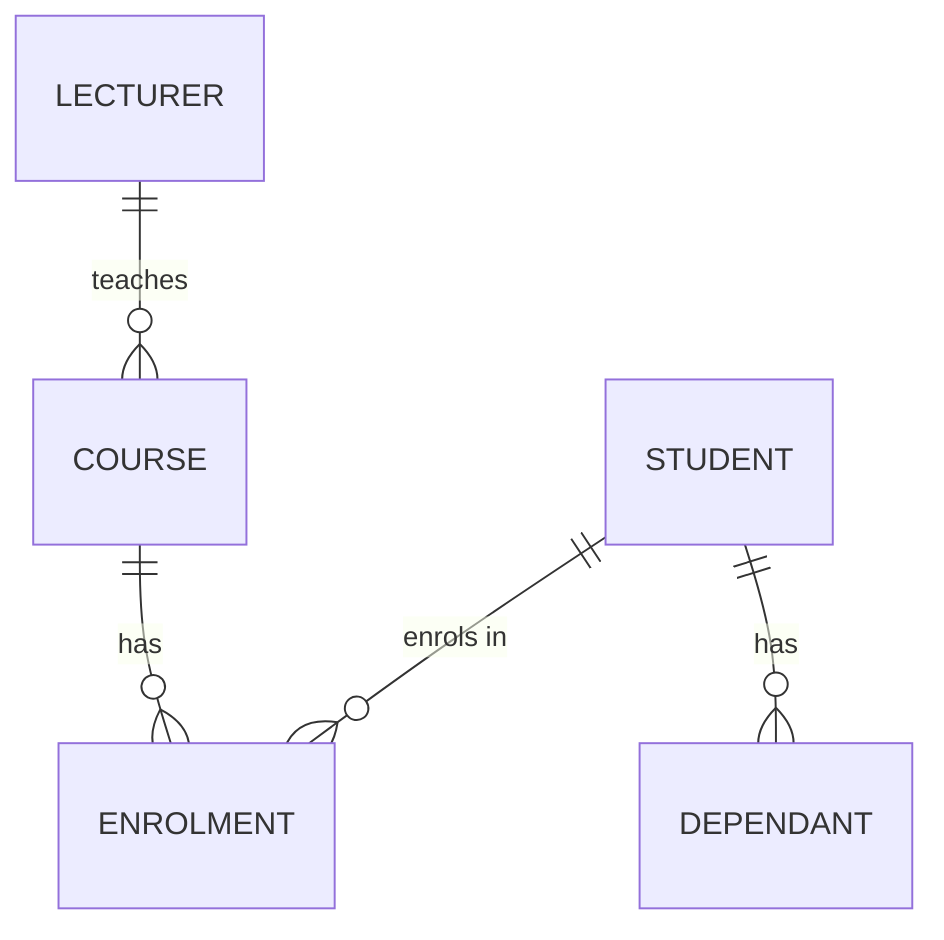

[README (1).md](https://github.com/user-attachments/files/34904088/README.1.md)
# SQL Database Projects (MySQL)

Practice database projects I built while studying **Introduction to Databases** (STADIO, BBIS) and completing the **Ultimate MySQL Bootcamp** on Udemy.

## What's in this repo

| File | What it covers |
|---|---|
| `01_campus_database.sql` | A campus database with students, lecturers, courses, enrolments and dependants. Includes primary and foreign keys, cascading deletes, a CHECK constraint, INSERT/UPDATE/DELETE, aggregate queries, GROUP BY, JOINs and a stored procedure. |
| `02_stock_joins.sql` | Clients and orders, showing the difference between INNER JOIN and LEFT JOIN. |

All names and emails in the sample data are made up.

## Database design (campus database)

## How to run

1. Install MySQL and MySQL Workbench.
2. Open a script in Workbench (File, then Open SQL Script).
3. Click the lightning bolt to run the whole script. Each script creates its own database, so you can run it more than once.

## Skills shown

- Designing tables with primary and foreign keys
- Keeping data consistent with constraints and `ON DELETE CASCADE`
- Writing `SELECT` queries with `WHERE`, `ORDER BY`, `GROUP BY` and aggregate functions
- Joining tables with `INNER JOIN` and `LEFT JOIN`
- Writing a stored procedure with an input parameter

## Author

**Zamantungwa Selai**
[LinkedIn](https://www.linkedin.com/in/zamantungwa-selai-692076257) · zamaselai@gmail.com
